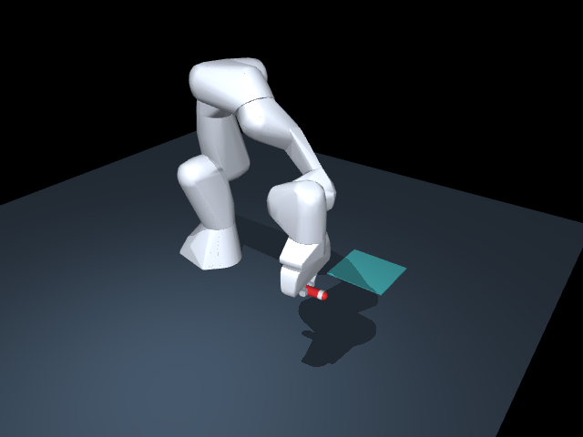

# 本地验证记录

日期：2026-11-06。运行平台：Windows，Python 3.13.5。
关键版本：MuJoCo 3.3.7、NumPy 2.2.6、PyTorch 2.10.0+cpu、
torchvision 0.25.0+cpu、Transformers 5.3.0、PEFT 0.18.1。

## 已实际运行

- `python -m pytest -q`：**56 passed**。涵盖物理抓取与搬运、掉落、空提交、越界、
  无效动作预算、真实本机 HTTP 闭环、自采数据过滤、训练标签屏蔽等。
- 小型随机初始化 **Qwen3.5 架构**：LoRA 前向、反向、保存、重载和生成通过。
  这用于接口验证，不是 Qwen3.5-4B 权重的训练结果。
- 使用官方 Qwen3.5-4B 的真实分词器和处理配置，离线验证推理与训练的提示 token 一致：
  528 个提示 token，示例动作及结束符共 6 个 token，提示部分全部屏蔽训练损失。
- 三个 Linux shell 脚本通过 Bash 语法检查；Python 环境通过依赖一致性检查。
- CPU 安装脚本已改为复用共享目录中的 Python，不再下载 uv 或解释器。本地验证了共享路径
  接受/拒绝检查、创建隔离虚拟环境及 pip 可用性；这些检查使用 Windows Python 3.13.5。
  用户随后提供的 Linux 离线安装与 GPU 运行结果见下文。
- 安装流程不再强制升级 pip。用真实 **pip 24.0** 和本地 HTTP 包索引验证了三种情况：
  第一次下载哈希不符、第二次重新下载成功；连续三次哈希不符时停止且未安装损坏包；
  版本不存在时立即停止。这些测试未访问真实 PyPI/PyTorch 下载线路，也不代表服务器网络已经恢复。
- 本地实际离线复制了 **13 个 CPU 版 Torch 及依赖包（约 0.5 GiB）** 到另一个独立环境，
  验证 `pip check`、Torch/torchvision 导入与 CPU NMS 算子、`python -m torch.distributed.run --help` 通过。
  确认目标 Torch 来自新环境，源文件样本的 SHA256 未改变；测试另覆盖复制后修改目标不影响源文件、
  不引入无关包、拒绝越界路径和不满足版本的依赖。CUDA 版复制与后续 GPU 推理已由用户日志确认。
- 用户提供的 DiG 环境版本：Torch 2.10.0+cu128、torchvision 0.25.0+cu128、Transformers 5.22.1。
  默认流程只复制 Torch 的依赖树，项目另装 Transformers 5.3.0；未在本机访问或修改用户的 DiG 环境。
- 离线包：已下载 **42 个 Linux x86_64 / CPython 3.11 安装包**，逐个核对 PyPI 官方 SHA256、
  文件长度、ZIP 完整性、Python/平台标签，并按 Python 3.11.18/Linux 条件校验依赖闭包。
  Torch/CUDA 由服务器现有环境提供，已从下载解析中显式排除；复制脚本会独立检查其依赖。
  真实 pip 24 使用 `--no-index --no-deps --require-hashes` 的跨平台安装预演选中了全部 42 个包。
  这属于离线文件与安装候选检查，不是本机运行 Linux 二进制或 H100 的结果。
- 离线入口检查代码和包文件哈希；测试覆盖同长度内容损坏、缺失/额外安装包、越界清单路径，
  以及错误 Python/glibc 版本的拒绝。
- 复制后的元数据缓存：固定目标目录时间戳后，在 Windows Python **3.11.18 和 3.13.5** 中
  均复现“文件已复制、当前进程仍发现零个包”的失败。加入 `importlib.invalidate_caches()` 后，
  Python 3.11.18 的 5 项复制工具测试通过，Python 3.13.5 的完整 48 项通过；未跳过原断言。
- 几何提示与详细反馈补丁：原 `base` 提示和通用拒绝原因保留；6 项新增回归验证越界字段、
  数值/边界、旧反馈兼容性及拒绝动作不改变物理。两种提示的本机 HTTP 闭环与训练数据来源保留测试通过。
  HTTP 测试服务使用规则策略返回动作，只验证接口和物理，不能当作 Qwen 推理成绩。
- 视频生成和静态图片渲染通过（本机，不代表服务器已经具备渲染条件）。

## 用户服务器日志确认

- Linux x86_64、Python 3.11.18、glibc 2.35；离线复制 30 个 Torch 依赖包（约 6.8 GiB）成功，
  随后离线依赖安装完成，`pip check` 通过。
- Torch 2.10.0+cu128、torchvision 0.25.0+cu128、Transformers 5.3.0、MuJoCo 3.3.7 已加载；
  仿真初始化、模型目录/权重文件检查、推理与 SFT 提示 token 一致性检查通过。
- 首版服务器测试为 **46 passed / 1 failed**，唯一失败位于上述包发现缓存检查；
  缓存修复后用户确认 **48 passed**。本次几何提示补丁的 56 项测试尚未在用户服务器重跑。
- CPU 准备日志中的 `cuda_available: false` 符合实例条件。后续 GPU 日志确认
  `cuda_available: true`、`visible_gpus: 4`，完整 Qwen3.5-4B 权重加载、HTTP 模型推理和仿真评测运行。
- 以下结果来自用户粘贴的服务器汇总，未由本机直接读取服务器文件。原模型、温度 0、
  状态输入、最多 20 动作、`test` 种子 0–19：

| 任务 | 成功 | 平均动作数 | 非法动作 | 运行异常 |
|---|---:|---:|---:|---:|
| 拿起 | 0/20 | 4 | 0 | 0 |
| 搬运 | 0/20 | 20 | 317 | 0 |

对应运行：`20261106T065858_731367Z_model_pick_test`、
`20261106T070033_988167Z_model_transport_test`。更早的 5 轮拿起运行未并入统计。
用户提供的首轮轨迹中，拿起动作把 TCP 目标恰好增加 0.06 m 后提交，实际抬升不足；
搬运把托盘表面坐标 `[0.45, 0.22, 0.004]` 作为 TCP 目标，z 低于 0.009 下限而重复被拒。
全部 317 次拒绝均为原通用越界原因；这里只确认首轮具体越界字段为 z。
这些记录用于诊断，因此后续独立评估应采用未查看过的种子。

`geometry_v1` 是人工补充几何/动作策略提示及详细拒绝反馈的实验，不是训练后的模型。
物理、奖励、动作空间和成功判定不变；当前尚无该版本完整模型的成功率结果。

## 规则策略的环境检查

每组 20 个场景，种子 0–19，最多 20 个动作。数据由
`python scripts/validate_physics.py` 生成。

| 任务 | 测试分布 | 成功次数 | 成功率 |
|---|---|---:|---:|
| 拿起 | 常规 | 20/20 | 100% |
| 搬运 | 常规 | 20/20 | 100% |
| 拿起 | 扩大摆放/尺寸范围并加入干扰物 | 19/20 | 95% |
| 搬运 | 扩大摆放/尺寸范围并加入干扰物 | 15/20 | 75% |

以上全部是 **scripted 规则策略** 的环境检查，不是 Qwen 成绩。
逐次结果、置信区间和依赖版本保存在
[examples/physics_validation.json](examples/physics_validation.json)。
较难场景中的失败被保留，未剔除失败种子。

## 尚未在本机验证

- 完整 Qwen3.5-4B 的本机运行；上面的服务器加载与基线由用户日志确认。
- 几何提示版本的 Qwen 成功率、自采成功轨迹及 4 卡 SFT。
- GRPO：本轮尚未实现；当前交付是任务环境、评测和自采成功 SFT。

## 规则搬运示例

[完整规则搬运视频](examples/scripted_transport.mp4)
